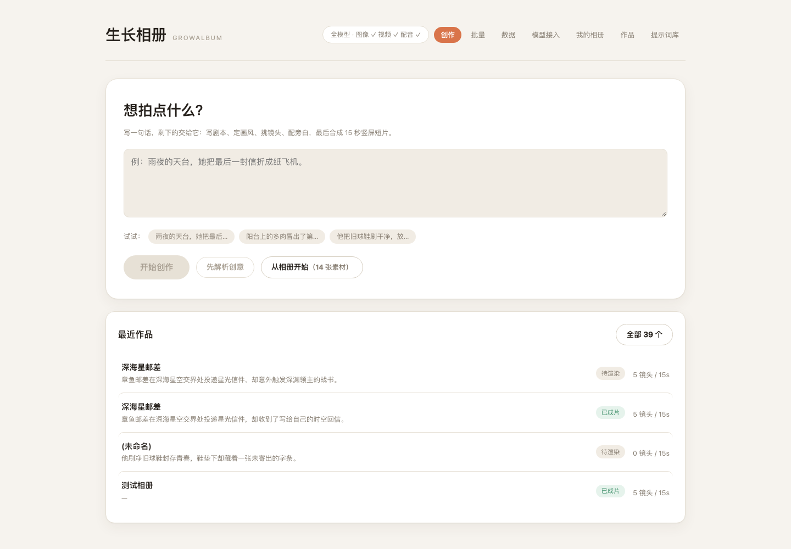
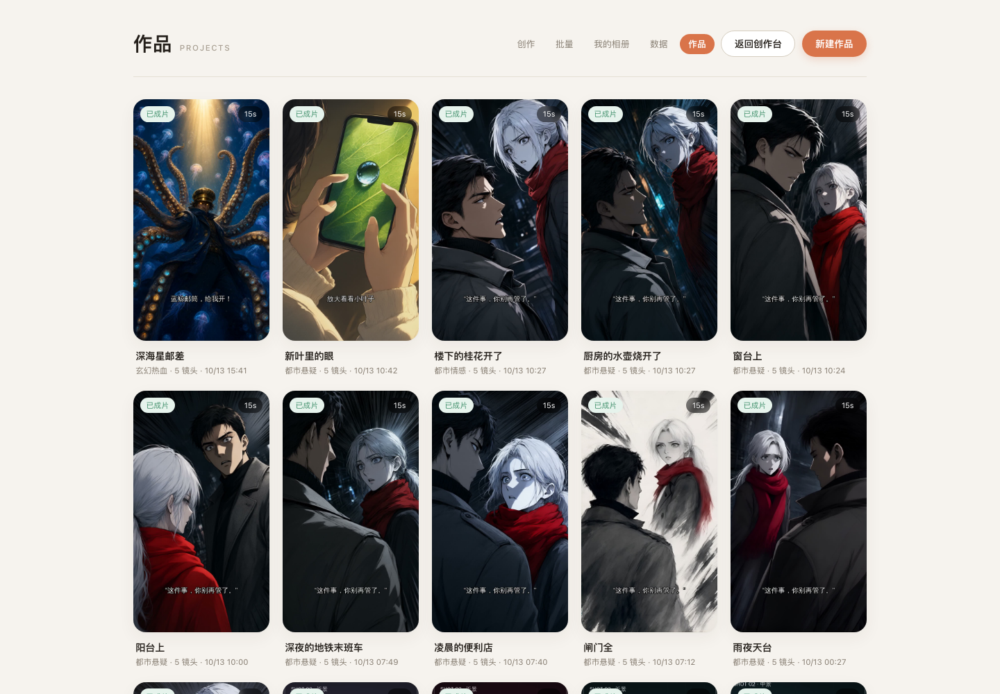
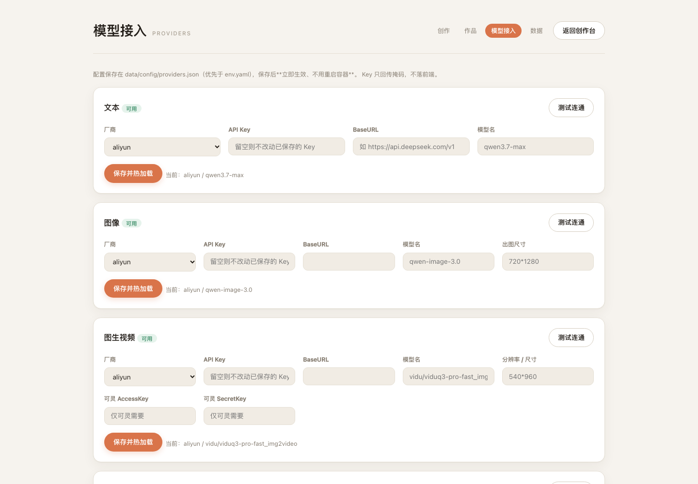
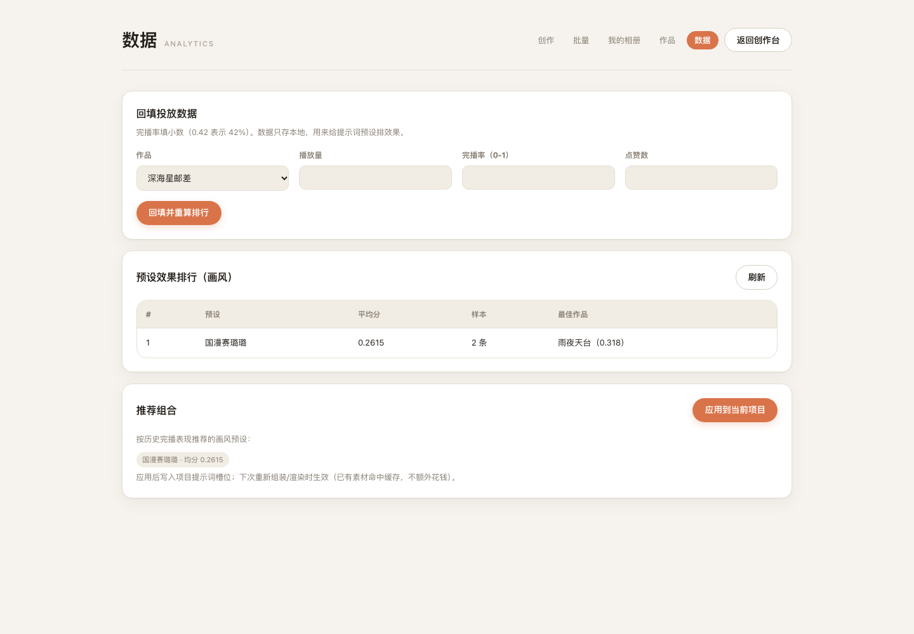

# 生长相册 GrowAlbum

把你的照片，养成一部短片：上传相册 → AI 读图写剧本、挑画面、配旁白、加运镜 → 导出 15 秒竖屏成片。

一句话定位：**素材驱动创意的个人影像工坊**。照片是主角，模型负责讲故事、配声音、让它动起来。

## 它能做什么

- **相册 → 故事**：模型读你的照片，写出一部短剧的梗概与 5 个节拍，直接立项
- **AI 挑图**：给每张照片按用途打分（钩子镜头 / 封面 / 空镜），出片时自动取高分图
- **风格反推**：从你自己的某张图反推出画风描述，存成可复用的提示词预设
- **照片当画面**：关键帧直接用你的照片（不调图像模型，0 元），也可切换成模型生成
- **图生视频**：把关键帧变成真动态镜头（按镜头计费），带成本护栏与可动性预判
- **配音 + BGM**：按镜头对齐的 TTS，混音时人声处自动压低 BGM（ducking）
- **质量把关**：一致性检查挑出"跑样"镜头、审核检查合规与图文一致性
- **发布包**：标题/简介/标签/封面文案 + 把 AI 生成标识写进成片文件元数据
- **数据闭环**：回填投放数据 → 预设效果排行 → 新项目推荐历史最优组合

## 界面

**创作台**：写一句话就能开始，也可以从相册出发。



**作品**：成片按竖版海报网格排列，点卡片就地播放、下载或删除。



**模型接入**：四个环节各自选厂商、填凭据、测试连通，保存后热加载不用重启。



**数据**：回填投放数据 → 预设效果排行 → 推荐组合一键应用。



## 快速开始（Docker）

```bash
cp env.example.yaml env.yaml     # 填入你的模型 Key
docker compose up -d --build
open http://localhost:8787
```

产物与数据落在 `./data`（已 gitignore，备份这一个目录即可）。

## 模型接入

四个环节都可独立配置，配置页在界面「模型接入」里，保存后**热加载、不用重启**：

| 环节 | 内置适配器 |
| --- | --- |
| 文本 | 阿里云百炼（Qwen）、Gemini 兼容、**OpenAI 兼容（一次覆盖十几家）** |
| 图像 | 百炼 Qwen-Image、Gemini / NanoBanana |
| 图生视频 | 百炼（Vidu）、可灵 Kling |
| 配音 | 百炼 Qwen3-TTS、IndexTTS-2 |

## 成本参考

| 场景 | 花费 |
| --- | --- |
| 用相册照片出片（不开图生视频） | ≈ 0.05 元/集 |
| 一集 15 秒，3 个镜头真动态 | ≈ 2.9 元 |
| 一集，5 个镜头全动态 | ≈ 4.7 元 |
| 改一处后重跑 | ≈ 0 元（关键帧/视频/配音三级缓存 + 预算护栏） |

## 架构

```
web/            Vue 3（无构建步骤，组件化）
src/
  providers/    模型注册表：每个环节可换厂商，配置热加载
  workflow/     工作流引擎 + 节点库 + 模板（固定链，可自定义编排）
  agents/       创意 / 总控 Agent
  services/     相册、提示词库、ffmpeg、缓存、成本、视觉理解
  domain/       数据模型（Project / Shot / Brief / Preset / Pricing）
docs/           架构说明与方案文档
```

文档导航：[架构](./docs/ARCHITECTURE.md) · [接口契约](./docs/API.md) · [产品现状与未实现清单](./docs/PRODUCT.md) · [开发说明](./docs/DEVELOPMENT.md)

设计原则：**流程固定、节点可见、失败可降级、花钱有护栏**。每个付费节点调用前先估算成本，超预算立即中止；素材按内容哈希缓存，重跑不重复付费。

## 说明

- 仅用于学习与交流，请遵守各模型厂商的服务条款与平台内容规范
- 生成内容发布时请遵守所在地对 AI 生成内容的标识要求（本项目已在发布包与文件元数据中写入标识）
